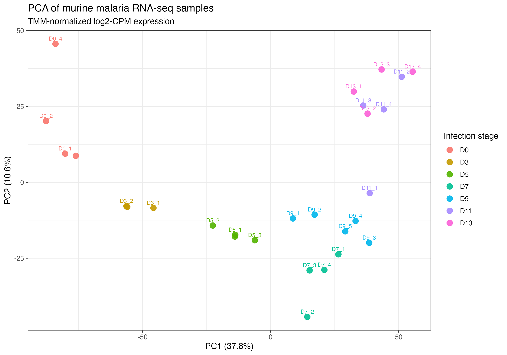
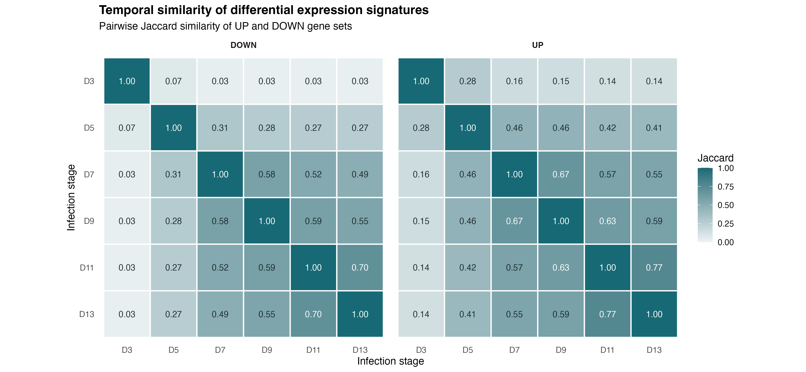
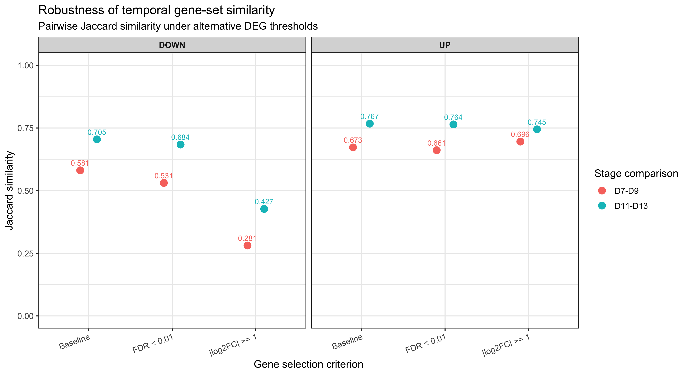
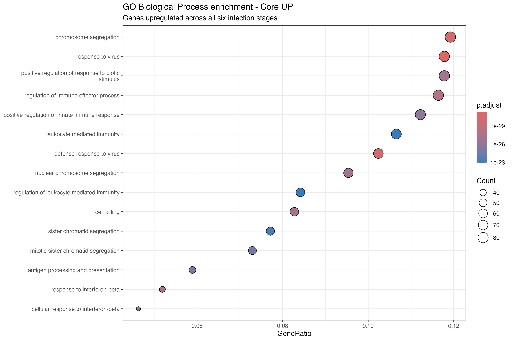
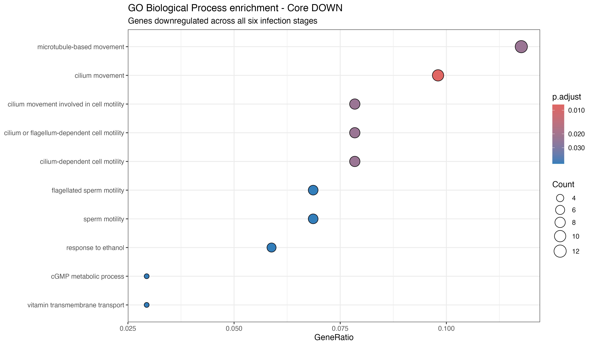
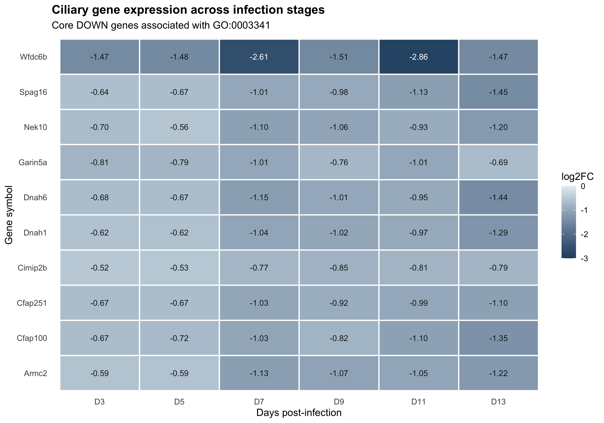

# Firmas transcriptómicas asociadas a etapas de infección en malaria murina

**Reanálisis independiente de RNA-seq de tejido pulmonar — GSE279789**

[English version](README.md)

## Descripción del proyecto

Este proyecto analiza cómo cambian las firmas de expresión génica diferencial en tejido pulmonar de ratón entre diferentes etapas experimentales de infección por *Plasmodium berghei* NK65. Se utilizan las matrices públicas de recuentos vinculadas al estudio de Chen et al. (2026), mediante un flujo analítico independiente basado en **edgeR**, **UpSetR** y **clusterProfiler**.

**Pregunta de investigación:** ¿Qué firmas de expresión diferencial son compartidas o específicas de determinadas etapas de infección y hasta qué punto dependen de los criterios estadísticos de selección?

Se trata de una **reanálisis computacional independiente**, no de una reproducción integral del estudio experimental ni del conjunto de análisis multi-ómicos originales. No se han obtenido nuevas muestras biológicas.

## Datos y diseño experimental

- **Procedencia:** NCBI GEO [GSE279789](https://www.ncbi.nlm.nih.gov/geo/query/acc.cgi?acc=GSE279789).
- **Estudio original:** [Chen et al., *mBio* (2026)](https://doi.org/10.1128/mbio.03938-25).
- **Modelo experimental:** *Mus musculus* (C57BL/6J), infectado por *P. berghei* NK65.
- **Tipo de datos:** RNA-seq bulk de pulmón, a partir de matrices de recuentos proporcionadas por GEO y los autores.
- **Muestras:** 28, distribuidas en siete grupos experimentales.

| Grupo | D0 | D3 | D5 | D7 | D9 | D11 | D13 |
|---|---:|---:|---:|---:|---:|---:|---:|
| Número de muestras | 4 | 3 | 4 | 4 | 5 | 4 | 4 |

D0 representa el grupo de referencia sin infección. Todos los contrastes comparan cada etapa infectada con D0. Los grupos corresponden a **animales distintos**, por lo que no representan mediciones longitudinales repetidas en los mismos individuos.

La matriz original contiene **54.232 identificadores génicos y 28 muestras**. Se identifican **12.860 genes con recuentos nulos en todas las muestras**. La comparación entre los archivos de GEO y los autores confirma la igualdad de identificadores y recuentos.

## Flujo de análisis

| Script | Objetivo |
|---|---|
| `scripts/00_download_inputs.sh` | Obtener los archivos originales y preparar `data/raw/`. |
| `scripts/01_validate_inputs.R` | Validar matrices, metadatos, identificadores y concordancia GEO–autores. |
| `scripts/02_exploratory_qc.R` | Realizar QC exploratorio a partir de recuentos por muestra. |
| `scripts/03_filter_normalize_pca.R` | Filtrar genes, normalizar mediante TMM y generar el PCA. |
| `scripts/04_differential_expression.R` | Ajustar el modelo de expresión diferencial y obtener seis contrastes. |
| `scripts/05_gene_set_intersections.R` | Calcular intersecciones UP/DOWN, diagramas UpSet y similitud de Jaccard. |
| `scripts/06_statistical_robustness.R` | Evaluar sensibilidad a umbrales y aplicar `glmTreat()`. |
| `scripts/07_functional_enrichment.R` | Enriquecimiento GO Biological Process y caracterización de genes ciliares. |

### Métodos estadísticos

1. **Filtrado y normalización:** `edgeR::filterByExpr()` retiene **25.586 genes** (47,18 % de los identificadores iniciales). Se aplica normalización TMM para obtener tamaños efectivos de biblioteca. La transformación log2-CPM se emplea en el análisis exploratorio PCA.
2. **Expresión diferencial:** Modelo lineal generalizado binomial negativo con cuasi-verosimilitud de edgeR (`glmQLFit()` y `glmQLFTest()`), utilizando una matriz de diseño sin intercepto (`~ 0 + group`). Se realizan seis contrastes, todos frente a D0: D3, D5, D7, D9, D11 y D13. Se utiliza **FDR de Benjamini–Hochberg < 0,05** y el signo del log2FC para clasificar UP y DOWN.
3. **Intersecciones:** Se calcula Jaccard entre conjuntos génicos UP/DOWN. La *firma core de seis etapas* es la intersección de los seis conjuntos en la misma dirección, **siempre respecto a D0**.
4. **Robustez:** Se comparan FDR < 0,05, FDR < 0,01 y una selección posterior de FDR < 0,05 con |log2FC| ≥ 1. Complementariamente se utiliza `edgeR::glmTreat()` con `lfc = 1` y `null = "interval"`, que considera la incertidumbre estadística al evaluar un umbral de efecto. **No equivale** a filtrar por |log2FC| una vez realizada la prueba habitual.
5. **Enriquecimiento funcional:** `clusterProfiler::enrichGO()`, ontología Biological Process, `org.Mm.eg.db`, identificadores Ensembl, ajuste BH, `pvalueCutoff = 0.05` y `qvalueCutoff = 0.20`. El universo es el conjunto de **25.586 genes evaluados**; el denominador de cada categoría depende de la anotación disponible.

El ajuste FDR se realiza dentro de cada contraste y no conjuntamente sobre los seis. No se estiman contrastes directos entre días consecutivos ni trayectorias longitudinales individuales.

## Resultados principales

### 1. Aumento de la expresión diferencial respecto al estado basal

| Contraste | UP | DOWN | Total DEG |
|---|---:|---:|---:|
| D3 vs. D0 | 1.087 | 234 | 1.321 |
| D5 vs. D0 | 3.203 | 2.145 | 5.348 |
| D7 vs. D0 | 6.162 | 5.797 | 11.959 |
| D9 vs. D0 | 5.984 | 5.941 | 11.925 |
| D11 vs. D0 | 6.531 | 6.149 | 12.680 |
| D13 vs. D0 | 6.506 | 6.049 | 12.555 |

La cantidad de genes significativos aumenta notablemente hasta D7 y permanece elevada en etapas posteriores. En el PCA de expresión log2-CPM normalizada, PC1 explica **37,78 %** de la variabilidad y PC2 **10,61 %**, con separación visible asociada a los grupos experimentales.



### 2. Solapamiento de firmas en etapas posteriores

| Pareja de conjuntos frente a D0 | Jaccard UP | Jaccard DOWN |
|---|---:|---:|
| D7 y D9 | 0,673 | 0,581 |
| D11 y D13 | 0,767 | 0,705 |

Bajo el criterio principal existen **862 genes UP** y **129 genes DOWN** compartidos por los seis contrastes.



Los diagramas UpSet detallan las intersecciones exactas de [UP](results/plots/upset_temporal_up.png) y [DOWN](results/plots/upset_temporal_down.png). Compartir significación frente a D0 **no implica** expresión constante entre días.

### 3. Robustez frente a las decisiones estadísticas

| Criterio para la firma core | UP | DOWN |
|---|---:|---:|
| FDR < 0,05 | 862 | 129 |
| FDR < 0,01 | 528 | 19 |
| FDR < 0,05 y \|log2FC\| ≥ 1 | 366 | 17 |
| `glmTreat()`: `lfc = 1`, `null = "interval"`, FDR < 0,05 | 60 | 1 |

En las parejas D7–D9 y D11–D13, la similitud de los conjuntos UP cambia relativamente poco entre umbrales. La de los conjuntos DOWN disminuye con mayor intensidad al imponer |log2FC| ≥ 1. La conclusión está restringida a los criterios y parejas evaluados.



### 4. Enriquecimiento funcional diferenciado

La sobre-representación GO Biological Process identifica **830 categorías enriquecidas** en la firma UP basal y **10** en la firma DOWN basal.

- **UP:** Regulación de procesos efectores inmunitarios, categorías de respuesta/defensa frente a virus, respuesta a interferón beta, citotoxicidad y segregación cromosómica. El término GO *response to virus* **no indica** infección vírica: el agente experimental es un parásito del género *Plasmodium*.
- **DOWN:** Destaca *cilium movement* (GO:0003341, *p* ajustada = **0,00849**), junto con motilidad basada en microtúbulos y términos axonemales relacionados. Las referencias a motilidad espermática comparten anotaciones ciliares o flagelares; **no implican** presencia de espermatozoides en tejido pulmonar.

Las categorías GO no son mecanismos independientes: muchas comparten genes y pueden ser redundantes.





Diez genes de la firma DOWN están anotados en *cilium movement*. Todos muestran log2FC negativo y FDR < 0,05 en los seis contrastes. El mapa de calor constituye una **descripción de los genes seleccionados**, no una validación biológica independiente.



## Reproducibilidad

### Requisitos

- Conda o Mamba para R y Bioconductor.
- Bash, `curl`, `gzip` y Git para obtener los datos.
- Acceso a Internet para la descarga inicial.

```bash
# Clonar el repositorio
git clone https://github.com/GuilleCiesx/Malaria-Timecourse-UpSetR-clusterProfiler-RNAseq.git
cd Malaria-Timecourse-UpSetR-clusterProfiler-RNAseq

# Crear y activar el entorno
conda env create -f environment.yml
conda activate malaria-rnaseq

# Descargar y preparar datos
bash scripts/00_download_inputs.sh

# Ejecutar secuencialmente los siete scripts R
for script in scripts/0[1-7]_*.R; do
  "$CONDA_PREFIX/bin/Rscript" "$script"
done
```

Se utiliza la ruta explícita de `Rscript` dentro de Conda para evitar seleccionar por accidente una instalación distinta de R en macOS.

Los archivos de entrada esperados en `data/raw/` son:

- `GSE279789_raw_counts.txt`
- `01_Bulk_Matrix.Rds`
- `01_Bulk_SampleTable.Rds`

La carpeta `data/` está excluida de Git. Los objetos intermedios se guardan en `data/processed/` y los resultados exportados en `results/`. Los comandos deben ejecutarse **desde la raíz del repositorio**.

**Entorno local comprobado (noviembre de 2026):** macOS Apple Silicon, R **4.5.3** de Conda, edgeR **4.10.7** y clusterProfiler **4.18.4**. El archivo Conda no fija todas las versiones transitivas y aún no se ha confirmado una instalación en un entorno completamente limpio. Algunas tablas detalladas no resultaron idénticas a las generadas anteriormente con otra versión de R/edgeR; los resúmenes incluidos aquí corresponden a la ejecución revisada con Conda.

## Limitaciones e interpretación

- El RNA-seq bulk de pulmón integra múltiples poblaciones celulares: los cambios pueden deberse a variaciones en composición celular, expresión intracelular o ambas.
- El análisis comienza con matrices de recuentos. No se repiten controles de calidad de lecturas originales, alineamiento ni cuantificación.
- Se comparan grupos **transversales**, no mediciones sucesivas de los mismos animales. Una firma compartida respecto a D0 no implica continuidad o estabilidad de expresión entre días.
- Los seis contrastes comparten el grupo control D0 y, por tanto, no son estadísticamente independientes.
- El solapamiento depende del criterio de selección y el tamaño de los conjuntos; GO depende de la anotación, la redundancia y el universo de referencia.
- La menor expresión de genes asociados a cilios **no demuestra una disfunción mucociliar** ni establece un mecanismo causal de lesión pulmonar. No se han realizado ensayos funcionales ni análisis de proporciones celulares.
- Este trabajo no reproduce experimentalmente ni valida los mecanismos originales sobre señalización IFN-γ e interacción entre células T y monocitos.

## Procedencia y atribución

**Publicación original:** Chen, S.-S., Yang, Q., Zhong, Y., et al. (2026). *Comprehensive immune profiling reveals IFN-γ signaling in T cells mediates parasite phagocytosis in a rodent malaria model.* **mBio**, 17(4), e03938-25. https://doi.org/10.1128/mbio.03938-25

**Fuentes públicas:** [NCBI GEO GSE279789](https://www.ncbi.nlm.nih.gov/geo/query/acc.cgi?acc=GSE279789) y repositorio de los autores [LuChenLab/PbNK65](https://github.com/LuChenLab/PbNK65).

La autoría del experimento y de los datos originales corresponde a los investigadores responsables del estudio. Este repositorio aporta un flujo de análisis y una interpretación computacional independientes.
