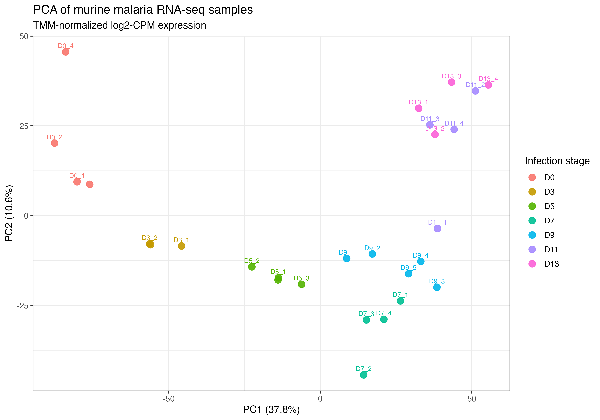
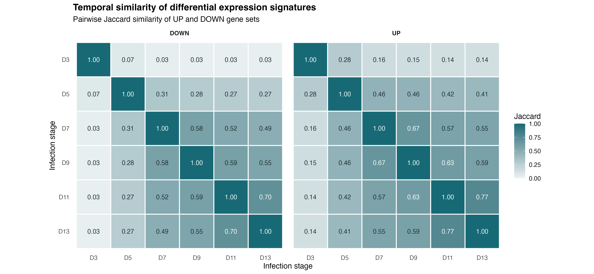
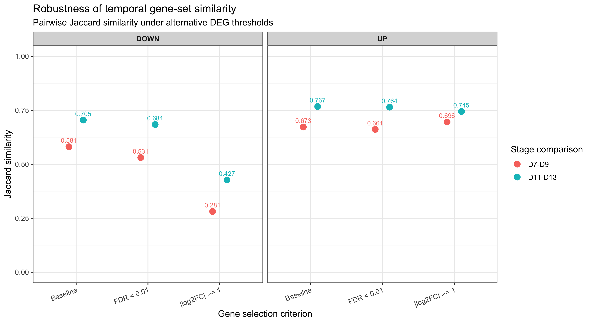
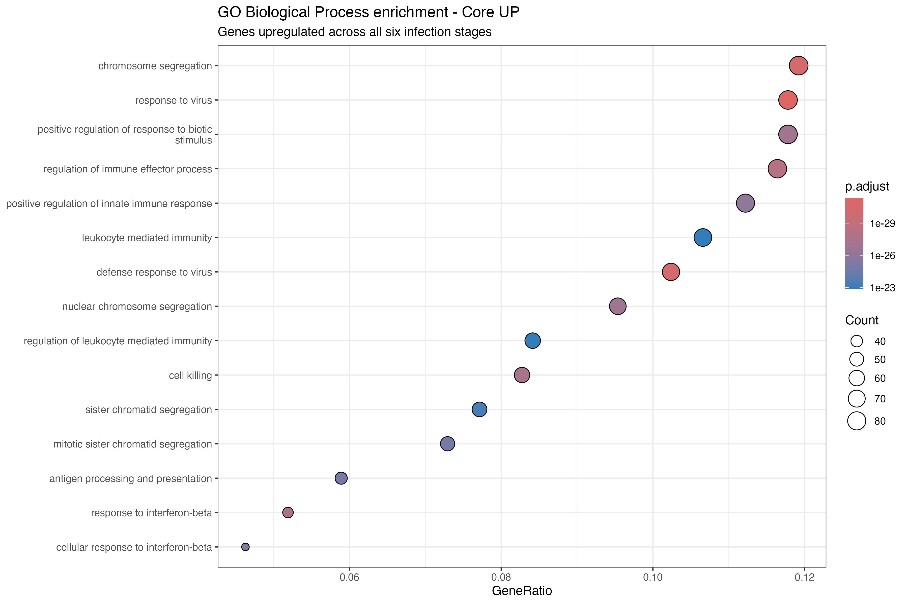
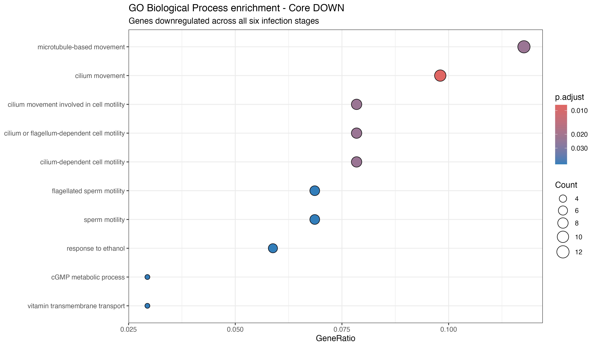
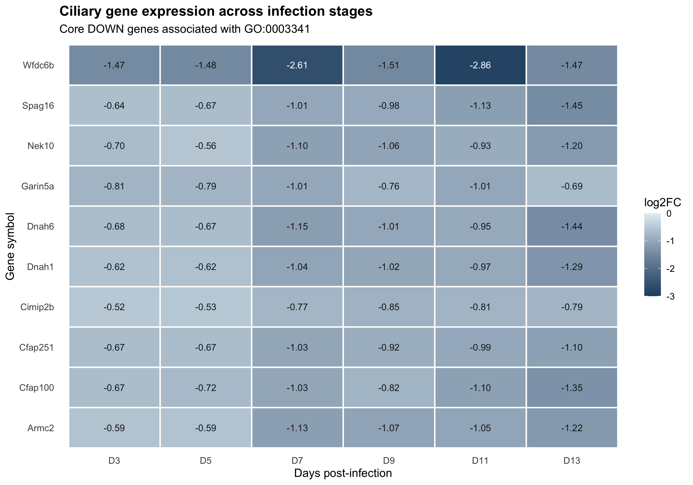

# Stage-associated transcriptomic signatures in murine malaria lung RNA-seq

**An independent reanalysis of public bulk RNA-seq data from GSE279789**

[Versión en español](README.es.md)

## Overview

This project examines how differential gene-expression signatures in mouse lung tissue vary across experimental stages of infection with *Plasmodium berghei* NK65. It reanalyses the public bulk RNA-seq count matrix associated with Chen et al. (2026), using an independent workflow based on **edgeR**, **UpSetR**, and **clusterProfiler**.

**Research question:** Which differential-expression signatures are shared or stage-associated across infection groups, and how sensitive are these patterns to statistical selection criteria?

This is an **independent computational reanalysis**, not a replication of the original study's full experimental or multi-omics workflow. No new biological samples were collected.

## Dataset and experimental design

- **Source:** NCBI GEO [GSE279789](https://www.ncbi.nlm.nih.gov/geo/query/acc.cgi?acc=GSE279789).
- **Source study:** [Chen et al., *mBio* (2026)](https://doi.org/10.1128/mbio.03938-25).
- **Organism and model:** *Mus musculus* (C57BL/6J), *P. berghei* NK65 infection.
- **Material:** Bulk RNA-seq from lung tissue, starting from author-provided and GEO gene-count matrices.
- **Samples:** 28 across seven independent experimental groups.

| Experimental group | D0 | D3 | D5 | D7 | D9 | D11 | D13 |
|---|---:|---:|---:|---:|---:|---:|---:|
| Samples | 4 | 3 | 4 | 4 | 5 | 4 | 4 |

D0 is the uninfected reference. All six differential-expression comparisons use D0 as their common comparator. These groups represent different animals at different experimental stages, **not repeated longitudinal measurements from the same animals**.

The original count matrix comprises **54,232 gene identifiers × 28 samples**. There are **12,860 genes with zero counts in every sample**. The validated author and GEO count matrices have identical gene identifiers, sample identifiers, and count values.

## Analysis workflow

| Script | Analysis | Main output |
|---|---|---|
| `scripts/00_download_inputs.sh` | Obtain source files and prepare `data/raw/` | Original count matrices and metadata |
| `scripts/01_validate_inputs.R` | Validate counts, identifiers, metadata, and GEO/author agreement | Input-validation report |
| `scripts/02_exploratory_qc.R` | Sample-level count-matrix QC | QC metrics and figures |
| `scripts/03_filter_normalize_pca.R` | Expression filtering, TMM normalization, log2-CPM, PCA | Filtered R objects and PCA figure |
| `scripts/04_differential_expression.R` | edgeR quasi-likelihood GLM, six contrasts vs D0 | Per-contrast DEG tables |
| `scripts/05_gene_set_intersections.R` | UP/DOWN intersections, UpSet plots, Jaccard similarity | Intersection tables and figures |
| `scripts/06_statistical_robustness.R` | Threshold sensitivity and `glmTreat()` | Robustness summaries and figure |
| `scripts/07_functional_enrichment.R` | GO Biological Process enrichment and ciliary-gene profiles | GO tables, dot plots, and heatmap |

### Statistical methods

1. **Filtering and normalization:** `edgeR::filterByExpr()` retains **25,586 genes** (47.18% of input rows). TMM factors adjust the effective library sizes; normalized log2-CPM values are used for exploratory PCA.
2. **Differential expression:** A group-specific design matrix (`~ 0 + group`) is fitted using an edgeR negative-binomial quasi-likelihood GLM (`glmQLFit()` and `glmQLFTest()`). Six contrasts compare D3, D5, D7, D9, D11, and D13 separately with D0. Genes with **Benjamini–Hochberg FDR < 0.05** are classified as UP or DOWN according to the sign of their estimated log2 fold change.
3. **Overlap:** The Jaccard index is computed for pairs of significant UP or DOWN gene sets. A *six-stage core* is the intersection of all six gene sets in the same direction, always **relative to D0**.
4. **Robustness:** The baseline is compared with FDR < 0.01 and with a post-hoc selection of FDR < 0.05 plus |log2FC| ≥ 1. Separately, `edgeR::glmTreat()` with `lfc = 1` and `null = "interval"` tests a fold-change threshold while accounting for statistical uncertainty. The post-hoc threshold and `glmTreat()` **are not equivalent procedures**.
5. **Functional enrichment:** `clusterProfiler::enrichGO()` tests GO Biological Process terms with `org.Mm.eg.db`, Ensembl gene identifiers, BH adjustment, `pvalueCutoff = 0.05`, and `qvalueCutoff = 0.20`. The background is the **25,586 genes tested for differential expression**; only genes with applicable annotations contribute to term-specific denominators.

The FDR adjustment for differential expression is performed within each contrast; it is not one global adjustment across all six contrasts. No direct adjacent-day contrast or longitudinal trajectory model is fitted.

## Main results

### 1. Differential expression increases after early infection

| Contrast | UP | DOWN | Total DEG |
|---|---:|---:|---:|
| D3 vs D0 | 1,087 | 234 | 1,321 |
| D5 vs D0 | 3,203 | 2,145 | 5,348 |
| D7 vs D0 | 6,162 | 5,797 | 11,959 |
| D9 vs D0 | 5,984 | 5,941 | 11,925 |
| D11 vs D0 | 6,531 | 6,149 | 12,680 |
| D13 vs D0 | 6,506 | 6,049 | 12,555 |

The number of significant genes rises markedly by D7 and remains high in later groups. PCA of filtered TMM-normalized log2-CPM expression explains **37.78%** and **10.61%** of variance on PC1 and PC2, respectively, with visible stage-associated separation.



### 2. Later-stage differential-expression signatures overlap

| Pair of stage-vs-D0 gene sets | Jaccard UP | Jaccard DOWN |
|---|---:|---:|
| D7 and D9 | 0.673 | 0.581 |
| D11 and D13 | 0.767 | 0.705 |

Across **all six** comparisons, **862 UP genes** and **129 DOWN genes** meet the baseline definition of a shared core signature.



The complete exact intersections are displayed in [UP](results/plots/upset_temporal_up.png) and [DOWN](results/plots/upset_temporal_down.png) UpSet figures. A high overlap does **not** establish constant expression between experimental stages.

### 3. UP signatures show greater threshold stability in the examined pairs

| Core signature definition | Core UP | Core DOWN |
|---|---:|---:|
| FDR < 0.05 | 862 | 129 |
| FDR < 0.01 | 528 | 19 |
| FDR < 0.05 and \|log2FC\| ≥ 1 | 366 | 17 |
| `glmTreat()`: `lfc = 1`, `null = "interval"`, FDR < 0.05 | 60 | 1 |

For D7–D9 and D11–D13, UP-set Jaccard similarity is relatively stable under the examined cutoffs, whereas DOWN-set similarity falls substantially when the post-hoc fold-change threshold is imposed. This statement is limited to the tested pairs and thresholds.



### 4. Shared UP and DOWN signatures have distinct GO annotations

GO Biological Process over-representation analysis finds **830 enriched terms** for the baseline UP core and **10** for the baseline DOWN core.

- **UP:** Immune effector regulation, defense/response-to-virus annotations, interferon-beta response, cell killing, and chromosome segregation. The GO label *response to virus* does **not** imply a viral infection; the experimental pathogen is a *Plasmodium* parasite.
- **DOWN:** Cilium movement (GO:0003341, adjusted *p* = **0.00849**), microtubule-based movement, and related axonemal motility terms. Terms referring to sperm motility share ciliary/flagellar annotations and do **not** indicate sperm cells in lung tissue.

GO terms are highly overlapping and are not independent pathways. The observed enrichments indicate associations of the selected gene sets, not functional measurements.





Ten genes belonging to the baseline DOWN core are annotated to **cilium movement**. All ten have negative log2FC and FDR < 0.05 in each of the six contrasts. Their selected expression profiles are visualized below. This is a **descriptive follow-up to enrichment**, not independent experimental validation.



## Reproducibility

### Requirements

- Conda or Mamba for the declared R/Bioconductor environment.
- Bash, `curl`, `gzip`, and Git for source-file preparation.
- Internet access for the initial data download.

```bash
# Clone the repository
# Replace the URL only if using a fork
git clone https://github.com/GuilleCiesx/Malaria-Timecourse-UpSetR-clusterProfiler-RNAseq.git
cd Malaria-Timecourse-UpSetR-clusterProfiler-RNAseq

# Reconstruct the declared environment
conda env create -f environment.yml
conda activate malaria-rnaseq

# Obtain source counts and author sample metadata
bash scripts/00_download_inputs.sh

# Run the pipeline from the repository root
for script in scripts/0[1-7]_*.R; do
  "$CONDA_PREFIX/bin/Rscript" "$script"
done
```

Use the **environment-specific** `Rscript` path above. On systems where a separate R installation precedes Conda in `PATH`, running plain `Rscript` may select the wrong interpreter.

Expected input files in `data/raw/`:

- `GSE279789_raw_counts.txt`
- `01_Bulk_Matrix.Rds`
- `01_Bulk_SampleTable.Rds`

The `data/` directory is excluded from Git. Intermediate R objects are written to `data/processed/`; figures and tables are written to `results/`. Run all scripts from the **repository root**.

**Tested local environment (November 2026):** macOS Apple Silicon, R **4.5.3** within Conda, edgeR **4.10.7**, clusterProfiler **4.18.4**. The declared Conda environment does **not** lock all transitive package versions, and an independent fresh-environment rebuild has not been verified. Earlier local runs using another R/edgeR version produced some non-identical detailed CSVs; these README summary statistics are taken from the reviewed Conda run.

## Scope and limitations

- Bulk lung RNA-seq mixes cell populations. Changes may arise from altered cell composition, expression within cells, or both; the analysis cannot distinguish these mechanisms.
- Data are analyzed from gene-count matrices. Read-level quality control, alignment, and quantification were performed upstream and are **not reassessed** here.
- Groups are **cross-sectional**, not a repeated-measures time series; shared significance against D0 does not establish continuous expression or direct changes between consecutive days.
- All contrasts use the same D0 controls and are therefore statistically dependent.
- Gene-set overlap depends on the statistical cutoff and on the size of each set; GO enrichment depends on annotation coverage, redundancy, and the selected gene universe.
- A lower expression signature associated with ciliary genes is **not evidence by itself** of reduced mucociliary function or a causal mechanism of lung pathology. No histological, cellular-composition, or functional assay is performed in this reanalysis.
- This project does not experimentally reproduce or validate the original paper's mechanistic claims about IFN-γ signaling and T cell–monocyte interactions.

## Data provenance and attribution

**Primary study:** Chen, S.-S., Yang, Q., Zhong, Y., et al. (2026). *Comprehensive immune profiling reveals IFN-γ signaling in T cells mediates parasite phagocytosis in a rodent malaria model.* **mBio**, 17(4), e03938-25. https://doi.org/10.1128/mbio.03938-25

**Public sources:** [GEO GSE279789](https://www.ncbi.nlm.nih.gov/geo/query/acc.cgi?acc=GSE279789) and the authors' [LuChenLab/PbNK65](https://github.com/LuChenLab/PbNK65) repository.

The authors retain credit for the biological experiment and source data. This repository presents a separate, independently developed computational analysis and interpretation of publicly available material.
